# Informe técnico — TarifaLatam

**Precio sugerido por noche para alojamientos de Airbnb en América Latina**

**Grupo 8** · Laboratorio de análisis avanzado · noviembre de 2026

**Integrantes y roles:** Rony Guerrero y Jesica Tarazona (app), Carolina Jiménez (modelado), Dulce Vargas (datos) y Rafael
Jaramillo (negocio). *Roles asignados al azar el 2026-11-06 y confirmados el 2026-11-11.*

**Repositorio:** <https://github.com/Rony0218/tarifalatam> · **App:** <https://tarifalatam-unaula.streamlit.app>
(Streamlit Community Cloud, desplegada el 2026-11-06)

**Cómo leer este informe.** Cada sección cita el archivo de `reports/` de donde salen sus cifras. Las figuras se regeneran con
`python scripts/report_figures.py`: las del análisis exploratorio salen solo del entrenamiento y las de resultados, de tablas
ya guardadas, sin volver a abrir la prueba. **Regla del informe: cada decisión va con su motivo.**

## Resumen ejecutivo

**TarifaLatam sirve como precio de referencia por noche para un anfitrión de Airbnb en cinco ciudades grandes de América
Latina, siempre con su rango típico y con la decisión final en manos del anfitrión.** En 29.721 anuncios de 13.345 anfitriones
que el modelo nunca vio, el precio sugerido se equivoca en promedio **41,40 USD por noche** frente a **57,44 USD** de una
regla simple (mediana por ciudad y tipo de habitación): **16,04 USD menos (27,9 %)**, con intervalo del 95 % de 14,36 a 17,84 USD,
y las seis ciudades mejoran. Los anuncios con un error mayor a la mitad de su precio bajan de 31,0 % a 18,7 %. El límite
principal es **Belice** (error de 246 USD por noche), además de las habitaciones de hotel y las compartidas. El modelo predice
el precio **publicado**, no el cobrado, y no responde si un inmueble se paga. **La app está desplegada** en
https://tarifalatam-unaula.streamlit.app.

El recorrido tuvo nueve etapas, cada una con su informe en `reports/`: caso de negocio, análisis exploratorio, limpieza y
partición, variables, torneo de modelos, optimización, validación, registro del modelo y despliegue. Lo importante es el
orden: primero se escribió qué cuesta equivocarse y contra qué regla había que ganar; se separó el 20 % de los anfitriones como
prueba cerrada antes de modelar; y las reglas para conservar una variable, usar parámetros optimizados o corregir el
logaritmo se escribieron **antes** de medir.

## 1. Caso de negocio

> Fuente: `reports/00_caso.md` (ficha de caso).

- **Pregunta:** ¿cuánto debería cobrar por noche un inmueble de Airbnb en América Latina, según sus características, su barrio
  y su ciudad? Hoy el anfitrión fija la tarifa a ojo o copiando a los vecinos.
- **Quién decide y qué:** el **anfitrión** fija su tarifa por noche (conserva la decisión final); el **inversionista** recibe ese
  precio por noche como un insumo más de sus cuentas. El modelo **no dice si un inmueble se paga**: la ocupación confiable, los
  costos y el valor de compra no están en los datos (decisión del grupo, 2026-10-31).
- **Con qué información:** las 13 características que el anfitrión conoce al publicar (ciudad, barrio, tipo de propiedad y de
  habitación, ubicación, huéspedes, habitaciones, camas, baños, si el baño es compartido y noches mínima y máxima).
- **Qué cuesta equivocarse:** un precio **muy bajo** pierde ingreso cada noche reservada; uno **muy alto** deja el inmueble vacío y
  la plataforma lo baja en las búsquedas. Para el inversionista, **sobrestimar** es peor: compraría un inmueble que no rinde lo
  esperado. Por eso se midió también un **costo asimétrico 2 a 1** (sobrestimar cuesta el doble), con 1,5 a 1 y 3 a 1 como
  sensibilidad. La proporción es un supuesto del grupo, no una medición: los datos no muestran cuánto cae la ocupación al
  subir el precio. Por eso orienta un control y no la métrica principal.
- **Cómo se mide el éxito:** **MAE en USD por noche** («el precio sugerido se equivoca en promedio X dólares»), que el anfitrión
  lee directo en dinero, con MAPE y R² como apoyo. **Línea base:** la mediana del precio por ciudad y tipo de habitación. **Meta**,
  escrita antes de abrir la prueba (propuesta de Rafael Jaramillo, PR #5): MAE al menos 20 % menor que la línea base,
  intervalo del 95 % de la diferencia entero bajo cero y ninguna ciudad peor que la línea base.
- **Tipo de problema:** **regresión** (se predice un número, el precio), con objetivo `log(price_usd)`.

## 2. Datos y limpieza

> Fuente: `reports/01_eda.md`, `reports/03_exclusiones.csv` y `src/tarifalatam/data/`.

### 2.1 Qué son los datos

Archivos `listings.csv.gz` de *Inside Airbnb* (licencia CC BY 4.0) de las siete ciudades de América Latina que publica, con
cortes del 14 al 25 de septiembre de 2026: **194.628 anuncios × 90 columnas**. La **unidad de análisis** es un anuncio en la
fecha de corte de su ciudad. El precio llega como texto (`"$1,234.00"`) en seis monedas, aunque siempre con el símbolo `$`.

| Ciudad | Moneda | Corte | Anuncios | Anfitriones |
|---|---|---|---|---|
| Río de Janeiro | BRL | 2026-09-22 | 48.247 | 26.869 |
| São Paulo | BRL | 2026-09-14 | 44.080 | 15.883 |
| Ciudad de México | MXN | 2026-09-23 | 30.468 | 13.381 |
| Buenos Aires (excluida) | ARS | 2026-09-23 | 29.753 | 14.623 |
| Bogotá | COP | 2026-09-14 | 19.505 | 8.497 |
| Santiago | CLP | 2026-09-23 | 18.904 | 9.920 |
| Belice | USD | 2026-09-25 | 3.671 | 1.054 |

Tras la limpieza quedaron **148.234 anuncios de seis ciudades**: 118.513 de entrenamiento y 29.721 de prueba. La figura 1
muestra el entrenamiento por ciudad: Río y São Paulo suman más de la mitad, y Belice es apenas el 2,2 %, lo que más adelante
explica parte de su error.

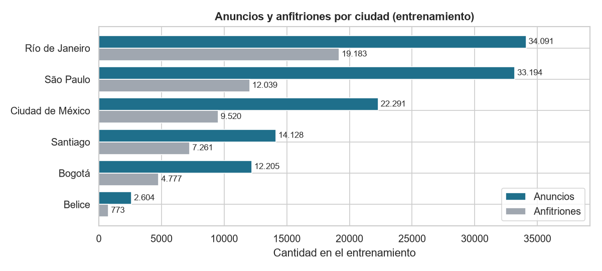

*Figura 1. Anuncios y anfitriones por ciudad en el entrenamiento (118.513 anuncios, 53.385 anfitriones).*

### 2.2 El objetivo: el precio por noche

Se convirtió cada precio a dólares con la **tasa oficial del banco central para la fecha del corte** de su ciudad (valores y
fuentes en `config.FX_RATES`, aprobados por el grupo el 2026-10-31). El precio en USD es muy asimétrico: unos pocos anuncios
cobran decenas de veces la mediana. En el entrenamiento su asimetría es 10,5; en logaritmo baja a 0,8 (figura 2). Por eso el
modelo aprende `log(price_usd)` y la predicción se devuelve a dólares con la exponencial.

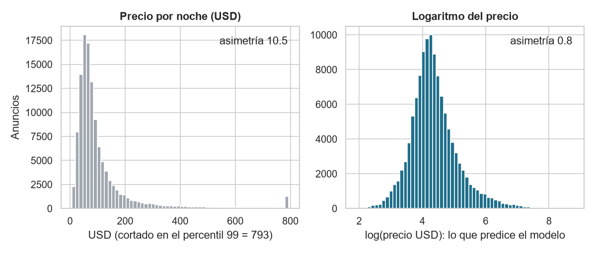

*Figura 2. Precio por noche en USD (izquierda, cortado en el percentil 99 solo para poder verlo) y su logaritmo (derecha).*

La figura 3 muestra que la **ciudad** fija el nivel de precio y que, dentro de cada ciudad, el **tipo de habitación** lo ordena:
la vivienda entera cuesta más que la habitación privada, y la compartida es la más barata. Belice está muy por encima del resto.
Por eso la línea base usa exactamente esas dos columnas.

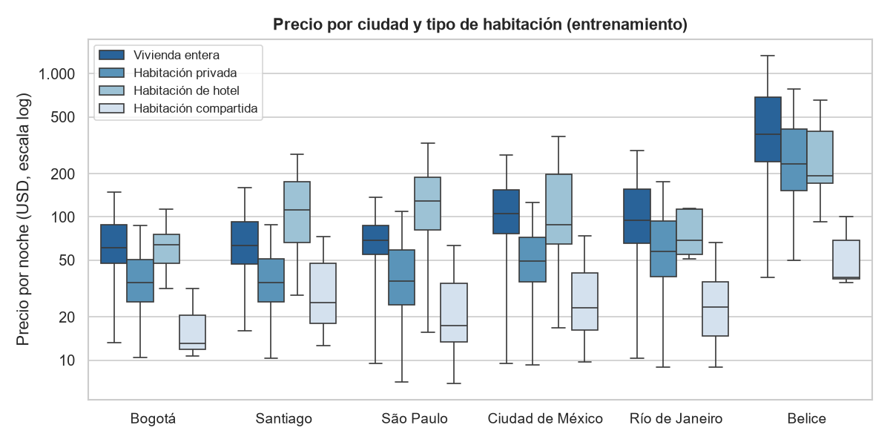

*Figura 3. Precio por ciudad y tipo de habitación en el entrenamiento (escala logarítmica, sin puntos extremos).*

### 2.3 Relación entre las variables numéricas

La figura 4 es la matriz de correlación de Spearman (por rangos, para que no la dominen los precios extremos) entre las ocho
variables numéricas del modelo y el logaritmo del precio, en el entrenamiento. Tres lecturas:

- **El tamaño es lo que más se relaciona con el precio:** huéspedes (0,49), habitaciones (0,43), camas (0,38) y baños (0,38).
- **Esas cuatro variables se parecen mucho entre sí** (huéspedes y camas 0,79; habitaciones y baños 0,62). Esto anticipa dos
  resultados: las razones de capacidad (idea 3) no agregan nada y, en la interpretación, el crédito se reparte entre ellas.
- **Las noches mínimas y máximas casi no se relacionan con el precio** (0,05 y −0,03), y la latitud y la longitud tampoco de
  forma lineal (0,14 y 0,04). La ubicación sí pesa, pero no en línea recta: depende de la ciudad y del barrio. Por eso los
  modelos de árboles (que capturan relaciones no lineales) le ganan al modelo lineal en el torneo.

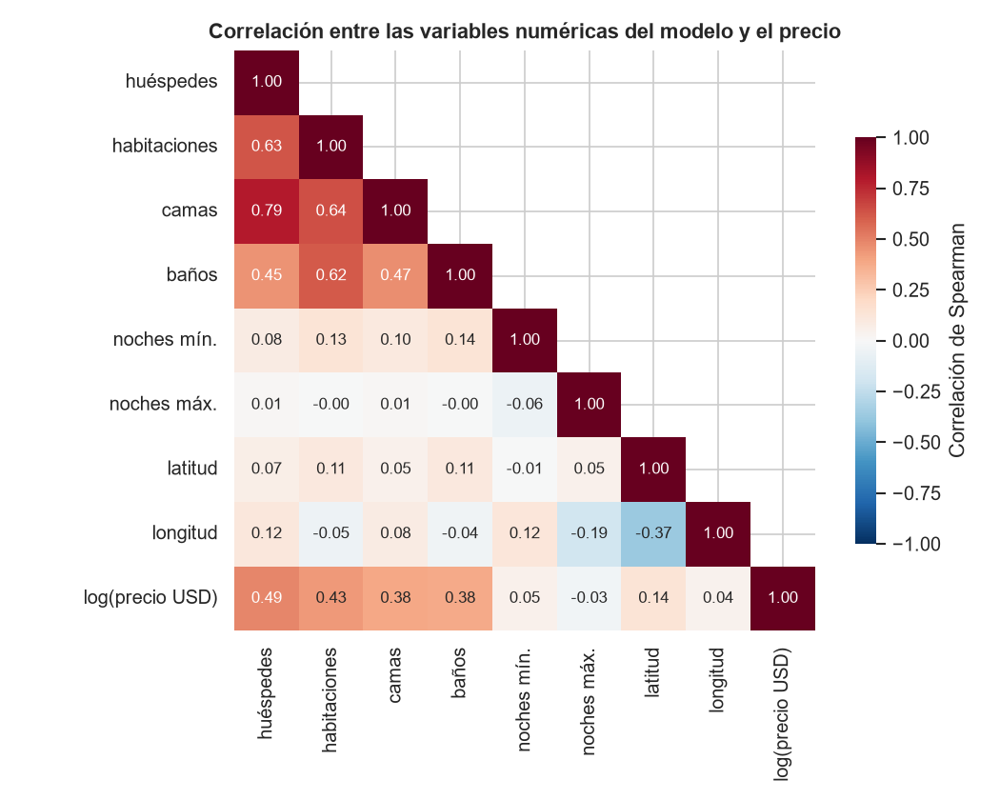

*Figura 4. Matriz de correlación de Spearman entre las variables numéricas del modelo y el logaritmo del precio
(entrenamiento).*

### 2.4 Decisiones de limpieza

El EDA encontró problemas de calidad y de fuga de información. Cada uno terminó en una decisión con su motivo, implementada en
`src/tarifalatam/data/` con pruebas. Las 11 primeras las aprobó el grupo el 2026-10-31; las dos últimas se tomaron el mismo día.

| # | Hallazgo (con cifra) | Decisión | Motivo |
|---|---|---|---|
| 1 | `price` es texto en el 100 % de los casos, en seis monedas | Convertir a número, pasar a USD y modelar `log(price_usd)` | Una sola escala; el logaritmo reduce la asimetría |
| 2 | 11.642 anuncios (6,0 %) sin precio; el 64 % con el calendario cerrado | Excluirlos | Son anuncios inactivos; imputar el objetivo sería inventarlo |
| 3 | `price_quote_price_per_night` = `price`; `estimated_revenue_l365d` = precio × ocupación | Eliminar `price_quote_*` (5) y `estimated_revenue_l365d` | Contienen la respuesta (fuga) |
| 4 | 10 columnas personales; 91 teléfonos y 9 correos en las descripciones | Eliminarlas al cargar, con el texto libre | Privacidad |
| 5 | 89.964 anfitriones; el 31 % de los anuncios es de anfitriones con 10 o más | Partir por `host_id` | Partir por fila inflaría la métrica |
| 6 | 12 columnas 100 % vacías; los baños están en `bathrooms_text` | Eliminarlas; extraer baños y baño compartido del texto | Rescatar lo que sí existe |
| 7 | 6.103 anuncios (3,1 %; 16,9 % en Bogotá) piden 30 noches o más | Excluirlos | Son arriendos mensuales, fuera del caso |
| 8 | 692 precios > 20 × la mediana de su ciudad y 61 < 0,1 × | Excluirlos (umbral calculado en entrenamiento) | Errores de captura que dominarían el error |
| 9 | 15,5 % sin reseñas; las notas están vacías justo en ellos | Indicador `has_reviews` e imputación dentro del `Pipeline` | El vacío significa «anuncio nuevo» |
| 10 | `maximum_nights` = 2.147.483.647 en 21; habitaciones > 10 y > capacidad en 124 | Marcarlos como vacíos | Son centinelas o datos del edificio |
| 11 | 123 tipos de propiedad (73 con < 30) y 371 barrios (146 con < 30) | Agrupar las raras en «Other» dentro del `Pipeline` | Ruido y categorías nuevas en la app |
| 12 | Buenos Aires: el 38,6 % de sus precios son múltiplos de 764,41 ARS, una tasa sin explicación verificable | **Excluir Buenos Aires** | Riesgo de la conversión a USD, más la inflación argentina |
| 13 | `license` solo existe en Bogotá y es un número de registro | Eliminarla | Delata la ciudad e identifica la propiedad |

Además se excluyeron los 11.701 anuncios marcados como *previous scrape* (del corte anterior; el 71,9 % no tiene precio). Los
umbrales (20 × la mediana, 30 noches, 10 habitaciones, 1.125 noches) se eligieron mirando todos los datos antes de partir y
quedaron congelados desde el 2026-10-30.

### 2.5 Partición por anfitrión

Un anfitrión puede tener muchos anuncios, a veces casi idénticos (3.076 «gemelos» del mismo anfitrión en el mismo edificio).
La figura 5 lo muestra en el entrenamiento: **el 31,5 % de los anuncios es de anfitriones con 10 o más anuncios.** Si se
partiera por fila, el modelo vería en el entrenamiento casi el mismo anuncio que después debe predecir, y la métrica saldría
inflada. Por eso **la partición y la validación cruzada son por anfitrión**:

- **Prueba:** `GroupShuffleSplit` con el 20 % de los anfitriones: 29.721 anuncios de 13.345 anfitriones.
- **Validación cruzada:** `GroupKFold` de 5 pliegues por anfitrión, calculados una sola vez y guardados en
  `data/processed/folds.csv`. Cada pliegue de validación tiene 10.677 anfitriones.
- Una prueba automática (`tests/test_split.py`) verifica que ningún anfitrión cae en dos particiones.

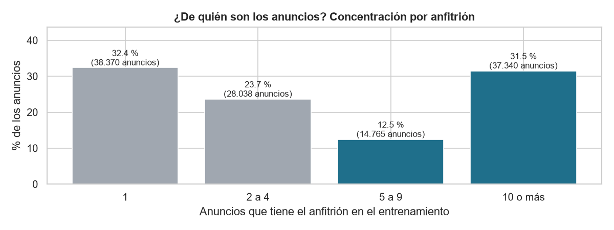

*Figura 5. Parte de los anuncios del entrenamiento según cuántos anuncios tiene su anfitrión.*

### 2.6 Datos personales

Los datos traen nombres, fotos, descripciones y URLs de los anfitriones. Se eliminan al cargar: `host_name`, `host_about`,
`host_location`, `host_url`, `host_profile_url`, `host_profile_id`, `host_picture_url`, `host_thumbnail_url`, `listing_url`,
`picture_url` y el texto libre. `host_id` se conserva **solo para partir** y nunca es variable del modelo. Los datos crudos y los
procesados no se suben al repositorio público (`.gitignore`).

## 3. Variables

> Fuente: `reports/04_features.md` y `reports/04_features_tabla.csv`.

- **Referencia (13 columnas):** categóricas `city`, `neighbourhood_cleansed`, `room_type` y `property_type` (las de menos de 30
  anuncios pasan a «Other»); numéricas `latitude`, `longitude`, `accommodates`, `bedrooms`, `beds`, `bathrooms_count`,
  `minimum_nights` y `maximum_nights`; e indicador `bathroom_shared`. Con LightGBM de parámetros fijos (300 árboles, tasa
  0,05, 31 hojas) dan un **MAE de 39,90 ± 1,73 USD** en los 5 pliegues por anfitrión.
- **Regla escrita antes de medir:** una idea se conserva solo si **mejora / ruido > 1** (mejora = MAE de la referencia − MAE de
  la variante; ruido = desviación del MAE de la variante entre pliegues) **y** si sus columnas se conocen al predecir un
  inmueble nuevo. Se escribió antes para no ajustarla después de ver un resultado.

| # | Idea | MAE (± ruido), USD | Mejora / ruido | Pliegues que gana | Decisión |
|---|---|---|---|---|---|
| 0 | Referencia (13 columnas) | 39,90 ± 1,73 | — | — | — |
| 1 | Distancia al centro de la ciudad (km) | 39,88 ± 1,71 | 0,01 | 3 de 5 | Descartar |
| 2 | Amenidades (conteo y 6 indicadores) | 38,99 ± 1,88 | 0,48 | 5 de 5 | Descartar |
| 3 | Razones de capacidad (personas por habitación y por baño, camas por persona) | 39,90 ± 1,70 | −0,00 | 3 de 5 | Descartar |
| 4 | Perfil del anfitrión (conteos, antigüedad, foto, identidad) | 40,21 ± 1,92 | −0,16 | 1 de 5 | Descartar |
| 5 | Precio típico del barrio (`TargetEncoder`) | 39,74 ± 1,69 | 0,09 | 5 de 5 | Descartar |

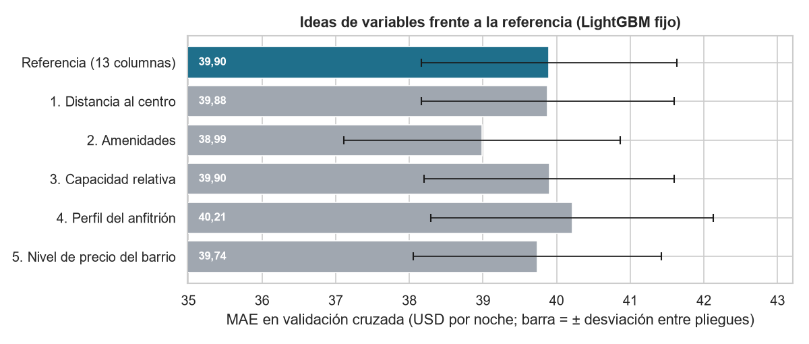

*Figura 6. MAE de la referencia y de cada idea (media y desviación entre los 5 pliegues por anfitrión).*

- **Resultado: se descartaron las cinco** (`config.FINAL_IDEAS = ()`). Las **amenidades** fueron la más cercana: bajaron el MAE
  0,91 USD y ganaron en los 5 pliegues, pero la mejora es menor que lo que varía el MAE de un pliegue a otro (1,88 USD). El
  grupo decidió aplicar la regla sin excepciones; además, conservarla habría sumado 7 preguntas a la app.
- **Columnas prohibidas (18):** el objetivo en sus tres escalas, los identificadores, los metadatos de la descarga y las
  variantes de noches del calendario. `tests/test_columns.py` falla si se pide una.
- **Columnas sospechosas (23): pesan, pero no se usan.** Ocupación, disponibilidad, reseñas y `host_is_superhost` bajan el MAE a
  37,39 USD (2,51 menos), pero son consecuencia del precio (un precio alto deja el calendario libre) y un inmueble nuevo no las
  tiene.
- **Aprendizaje para una versión 2:** la regla no es pareada. Con el ruido de la diferencia pliegue a pliegue, las amenidades
  (4,42) y el precio del barrio (1,54) habrían pasado. No se cambió, porque sería cambiar la regla después de ver el
  resultado; conviene definir el ruido pareado desde el inicio de la próxima ronda.

## 4. Torneo de modelos

> Fuente: `reports/05_torneo.md`, `reports/05_torneo_tabla.csv` y `reports/05_torneo_por_ciudad.csv`.

- **Validación común:** todos los candidatos con los mismos 118.513 anuncios, las mismas 13 columnas y los mismos 5 pliegues
  por anfitrión. Todos aprenden `log(price_usd)`.
- **Candidatos, con parámetros de partida (sin optimizar):** `Ridge(alpha=1.0)`; bosque aleatorio (200 árboles, 3 anuncios
  mínimos por hoja, 50 % de las variables por corte); LightGBM (300 árboles, tasa 0,05, 31 hojas); y la línea base.

| Modelo | MAE (USD, ± ruido) | MAPE (%) | R² (log) | RMSE (USD) | Sesgo (USD) | Peor ciudad (MAE) |
|---|---|---|---|---|---|---|
| Bosque aleatorio | **39,67 ± 1,60** | 32,78 | 0,638 | 110,52 | −13,01 | Belice (204,10) |
| LightGBM | 39,90 ± 1,73 | 32,70 | 0,636 | 111,05 | −14,03 | Belice (206,49) |
| Ridge | 43,64 ± 1,88 | 37,08 | 0,569 | 121,94 | −15,41 | Belice (226,49) |
| Línea base | 55,90 ± 2,55 | 43,54 | 0,278 | 152,90 | −32,64 | Belice (316,13) |

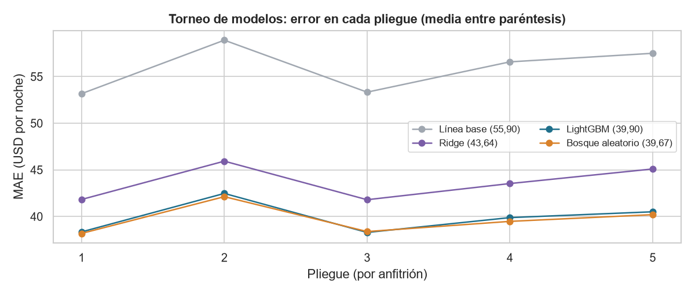

*Figura 7. MAE de cada candidato en cada uno de los 5 pliegues por anfitrión.*

- **Lectura:** los dos modelos de árboles le ganan a Ridge en los 5 pliegues (diferencia / ruido de 6,9 y 7,7) y a la línea base
  por unos 16 USD por noche (29 % menos error). Entre ellos la diferencia es pequeña: el bosque le gana a LightGBM por 0,23 USD
  en 4 de 5 pliegues, con diferencia / ruido de 1,13.
- **Errores grandes en pocos anuncios:** en todos los modelos el RMSE es casi el triple del MAE (los precios más altos). Por eso
  la métrica principal es el MAE.
- **Todos subestiman** en promedio (sesgo negativo): predecir en logaritmo y volver con la exponencial se acerca a la mediana,
  que es menor que el promedio en precios asimétricos.
- **Finalistas: bosque aleatorio y LightGBM.** El torneo **descarta, no corona**: compara configuraciones sin afinar, y la
  optimización podía cambiar el orden entre dos modelos separados por 0,23 USD.

## 5. Optimización y seguimiento

> Fuente: `reports/06_optimizacion.md`, `reports/06_optimizacion_tabla.csv` y `reports/06_best_params.json`.

- **Método y presupuesto:** Optuna (`TPESampler`, semilla 42), **30 ensayos por finalista (60 en total)**, fijados antes de
  empezar, minimizando el MAE medio de los pliegues.
- **Espacio de búsqueda** (aprobado antes de buscar). LightGBM: tasa de aprendizaje 0,01–0,2, árboles 200–1.000, hojas 15–255,
  anuncios mínimos por hoja 10–200, submuestreo de anuncios 0,6–1,0 y de variables 0,5–1,0, regularización L2 0,001–10. Bosque:
  200 árboles fijos, profundidad 8–40, anuncios por hoja 1–20, variables por corte 0,2–1,0.
- **Anfitriones reservados:** la mejor puntuación de una búsqueda es optimista, porque se eligió entre muchas. Por eso se
  reservó el **25 % de los anfitriones del entrenamiento** (13.347 anfitriones, 29.023 anuncios) que la búsqueda nunca vio; la
  búsqueda usó los otros 40.038 anfitriones.

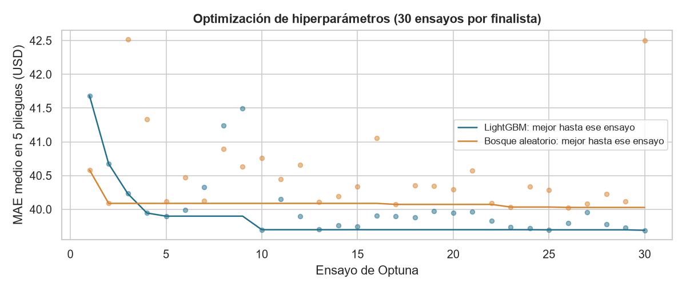

*Figura 8. MAE de cada ensayo de Optuna (puntos) y el mejor hasta ese ensayo (línea), por finalista.*

- **Búsqueda:** el mejor LightGBM fue el ensayo 30 (39,69 USD en los pliegues de búsqueda) y el mejor bosque, el 26 (40,03).
  La figura 8 muestra que LightGBM mejora con la búsqueda más que el bosque, que se estanca pronto.
- **¿La mejora fue real?** Regla escrita antes: se usan los parámetros optimizados solo si todo el intervalo del 95 % de la
  diferencia queda bajo cero (1.000 remuestreos de anfitriones completos).

| Modelo | MAE de partida | MAE optimizado | Diferencia | Intervalo 95 % |
|---|---|---|---|---|
| Bosque aleatorio | 38,87 | 38,70 | −0,17 | [−0,28; −0,06] |
| LightGBM | 38,86 | 38,52 | −0,34 | [−0,64; −0,01] |

- **Entre los dos optimizados hubo empate** (diferencia de 0,17 USD, intervalo [−0,20; +0,55]).
- **Decisión y excepción declarada:** la regla escrita elegía el bosque (más rápido de ajustar: 2,41 s frente a 3,09 s por
  pliegue); el grupo eligió **LightGBM optimizado** por su MAE menor y por ser más simple de operar en la app. **Es una excepción
  a la regla, decidida después de ver el resultado**, y así queda registrada (`config.STAGE7_MODEL`).
- **Parámetros finales de LightGBM:** 522 árboles, tasa de aprendizaje 0,0167, 215 hojas, 19 anuncios mínimos por hoja,
  submuestreo 0,928 de anuncios y 0,542 de variables, regularización L2 2,886 (se arma con `make_model`, que fija
  `subsample_freq=1` y `random_state=42`).
- **Seguimiento:** las 60 ejecuciones quedaron en **MLflow local** (experimento `tarifalatam-optimizacion`), cada una con sus
  hiperparámetros, 7 métricas y etiquetas. Se ven con `mlflow ui --backend-store-uri sqlite:///mlflow_local.db`.
- **Advertencia:** el 38,52 es optimista. Los mismos anfitriones reservados se usaron en cuatro decisiones. La cifra honesta es
  la de la prueba (sección 6).

## 6. Validación e interpretación

> Fuente: `reports/07_validacion.md`, `reports/07_metricas_test.json`, `reports/07_segmentos.csv` y `reports/07_shap_global.csv`.

### 6.1 Decisiones congeladas antes de abrir la prueba

Se congelaron el 2026-11-05 a las 17:42, solo con los anfitriones reservados:

- **Modelo:** LightGBM optimizado con las 13 columnas, entrenado con todo el entrenamiento.
- **Sin corrección del logaritmo:** el factor de Duan (1,1243) sube todos los precios para acercar el promedio, pero empeoró el
  MAE de 38,52 a 41,16 USD (diferencia +2,64, intervalo [+2,21; +3,06]). El MAE premia acercarse a la mediana, que es lo que ya
  da la exponencial de la predicción.
- **Cómo se entrega el precio:** redondeado al dólar, con un **rango típico** de su ciudad: el precio por los percentiles 25 y 75
  de *precio real / precio sugerido* en los reservados (Bogotá 0,781–1,149; Santiago 0,815–1,152; São Paulo 0,822–1,209; Ciudad
  de México 0,773–1,250; Río 0,724–1,277; Belice 0,744–1,354). Así, un precio sugerido de 100 USD en Bogotá se muestra como «de
  78 a 115 USD».
- **Meta de éxito:** la de la sección 1.

### 6.2 La prueba, abierta una sola vez

La prueba se abrió el **2026-11-05 a las 18:09:33**, después de congelar las decisiones (constancia en
`reports/prueba_abierta.txt`). Las otras dos lecturas quedaron declaradas y ninguna cambió una decisión: la sensibilidad sin el
filtro de extremos, en la misma ejecución, y la comprobación de que `models/model.joblib` da el mismo MAE.

| Métrica | Modelo | Línea base |
|---|---|---|
| MAE (USD por noche) | **41,40** [38,29; 45,01] | 57,44 [53,18; 62,50] |
| MAPE (%) | 31,78 | 42,39 |
| R² (sobre el logaritmo) | 0,67 | 0,33 |
| RMSE (USD) | 120,53 | 159,57 |
| Sesgo medio (USD, sugerido − real) | −14,36 | −34,86 |
| Costo 2 a 1 (control) | 54,92 | 68,73 |
| Anuncios con error > 50 % del precio | 5.549 (18,7 %) | 9.204 (31,0 %) |

**La meta se cumple en sus tres condiciones:** el MAE es 27,9 % menor que el de la línea base (diferencia −16,04 USD, intervalo
del 95 % por anfitrión [−17,84; −14,36], entero bajo cero) y las seis ciudades mejoran. El costo 2 a 1 también es menor con el
modelo en las tres proporciones probadas. **Declaración:** la prueba excluye 86 anuncios con precio extremo (regla de la
limpieza); sin ese filtro el MAE sube a 56,81 USD (línea base 73,94).

### 6.3 Errores por segmento

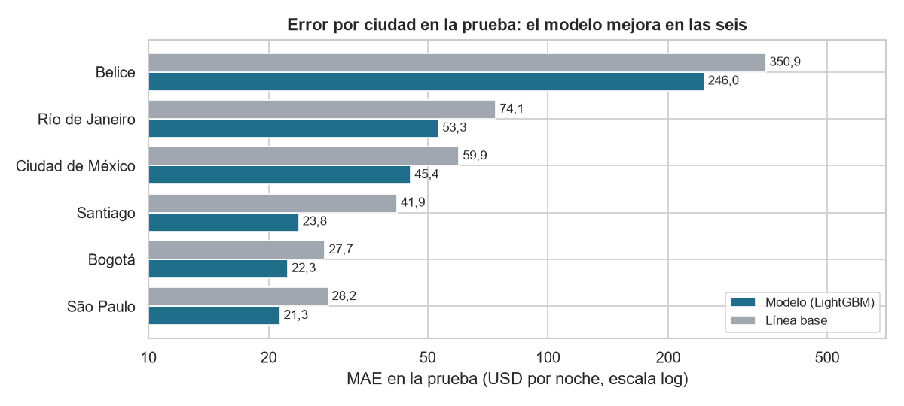

*Figura 9. MAE por ciudad en la prueba: modelo contra línea base (escala logarítmica).*

| Tipo de habitación | Anuncios | MAE modelo (USD) | MAE línea base (USD) | Sesgo (USD) |
|---|---|---|---|---|
| Vivienda entera | 23.855 | 42,61 | 60,93 | −13,80 |
| Habitación privada | 5.609 | 35,62 | 42,13 | −16,00 |
| Habitación de hotel | 76 | 149,20 | 196,60 | −111,34 |
| **Habitación compartida** | 181 | 15,42 | **12,98** | +2,62 |

- **Ciudades:** el MAE va de 21,35 USD en São Paulo, 22,32 en Bogotá y 23,80 en Santiago a 45,38 en Ciudad de México y 53,25 en
  Río. **Belice es el límite: 245,96 USD de error y sesgo de −110 USD.** Es la ciudad más pequeña, con muchas villas y casas de
  playa de precio muy alto que se parecen poco a las otras cinco. Aun así mejora frente a su línea base (350,88), por eso se
  cumple la condición (c).
- **Tipo de habitación:** las de hotel fallan mucho y en las **compartidas** el modelo es **peor que la línea base**. La meta no lo
  pedía (mira ciudades), pero se declara como límite.
- **Sesgo:** el sesgo medio es negativo en todas las ciudades: cuando el modelo subestima, se equivoca por más dinero (los
  precios altos). Para el inversionista es conservador; para el anfitrión de un inmueble caro, el precio sugerido se queda
  corto.

### 6.4 Precio real contra predicho (en lugar de la curva ROC/AUC)

**Por qué no hay curva ROC/AUC:** esa curva mide qué tan bien un modelo separa dos clases (por ejemplo, «paga» o «no paga») y
solo existe en problemas de **clasificación**. TarifaLatam es un problema de **regresión**: predice un número, el precio. Su
equivalente es comparar el precio real con el predicho y mirar los residuos (figura 10).

Para no abrir otra vez la prueba, la figura usa **predicciones fuera de pliegue en el entrenamiento**: el mismo LightGBM
optimizado, entrenado 5 veces, y cada anuncio predicho por un modelo que no vio a su anfitrión. En esas predicciones el MAE es
39,21 USD, el R² sobre el logaritmo 0,65, el sesgo −13,36 USD y el 18,9 % de los anuncios tiene un error mayor a la mitad de su
precio (`reports/figuras/F11_metricas.json`). Son cifras un poco más optimistas que las de la prueba (41,40 USD), porque los
hiperparámetros se eligieron con estos mismos pliegues; la cifra oficial es la de la sección 6.2.

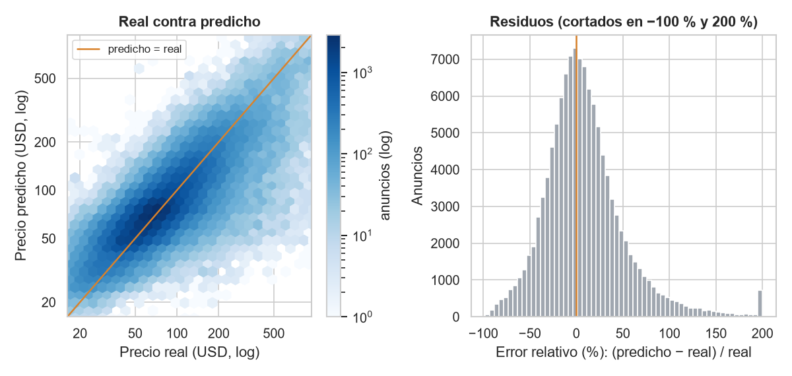

*Figura 10. Izquierda: precio real contra predicho (cada hexágono cuenta anuncios; la diagonal es el acierto perfecto).
Derecha: error relativo de cada anuncio. Predicciones fuera de pliegue en el entrenamiento.*

**Lectura:** la nube sigue la diagonal, pero se «aplana» en los extremos. Los precios muy bajos se sobrestiman y los muy altos se
subestiman: el modelo tira hacia el precio típico de inmuebles parecidos. El histograma está centrado cerca de cero, con una
cola larga a la derecha: anuncios para los que el modelo sugiere mucho más que su precio, en su mayoría baratos (como se ve a
la izquierda).

### 6.5 Interpretación

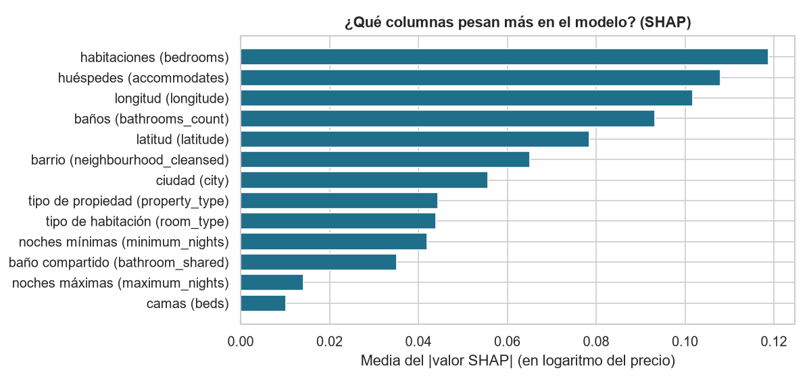

*Figura 11. Importancia global de cada columna: promedio del valor SHAP absoluto en 2.000 anuncios del entrenamiento.*

- **Qué pesa:** sobre todo el **tamaño** (habitaciones, huéspedes, baños) y la **ubicación** (longitud, latitud, barrio, ciudad).
  Un aporte de 0,10 en logaritmo equivale a cerca de un 10 % del precio.
- **Dos ejemplos de la prueba:** con el error mediano, un apartamento entero en São Paulo para 2 huéspedes (real 89 USD, sugerido
  73); con el mayor error, una habitación privada en Belice para 16 huéspedes (real 6.000 USD por noche, sugerido 391). El modelo
  ya sube mucho el precio por la ciudad y la capacidad, pero un precio así queda fuera de lo que aprendió.
- **Límite de la explicación:** los valores SHAP explican al **modelo**, no al mundo. No prueban causa, y latitud, longitud,
  barrio y ciudad están correlacionadas y se reparten el crédito (como las variables de tamaño de la figura 4).
- **Revisión de los subagentes:** el `auditor-de-fuga` no encontró fuga que invalide la métrica y el `revisor-de-codigo-ia`
  recomendó «aceptar con cambios»; los hallazgos y lo que se hizo están en `reports/07_validacion.md`.

## 7. Registro del modelo

> Fuente: `reports/08_registro.md` y `models/ficha_modelo.md`.

- **Dónde quedó:** modelo `tarifalatam_precio_noche`, **versión 1, alias `champion`**, en **MLflow local** (experimento
  `tarifalatam-modelo-final`). Lo registró Rony Guerrero el 2026-11-05 a las 18:12.
- **Por qué local y no Databricks:** no había conexión configurada y las 60 ejecuciones de la etapa 6 ya estaban en el local. Es una
  **excepción a la regla 7 de `CLAUDE.md`**, decidida por el grupo y anotada en `especificacion-proyecto.md`.
- **Ida y vuelta:** el modelo recuperado con `models:/tarifalatam_precio_noche@champion` predice igual que el local (200 de 200).
- **Exportación y esquema:** `models/model.joblib` (10 MB, mismo MAE en la prueba) y `models/input_schema.json`, con las 13
  columnas de entrada, los barrios por ciudad, los rangos posibles y el rango típico; la salida es el logaritmo del precio en
  USD. Se guarda con `cloudpickle`: **solo se cargan modelos propios**, porque un archivo pickle puede ejecutar código al
  cargarse.
- **Reproducibilidad:** el registro local no se sube a Git; sí están `models/model.joblib` y la forma de regenerarlo (anexo).

## 8. Despliegue

> Fuente: `reports/09_despliegue.md`.

- **Estado: desplegada** el 2026-11-06 en Streamlit Community Cloud: **https://tarifalatam-unaula.streamlit.app** (repo
  `Rony0218/tarifalatam`, rama `main`, `app/streamlit_app.py`, Python 3.12). En local corre con
  `streamlit run app/streamlit_app.py`.
- **Cómo funciona:** el anfitrión describe su inmueble (ciudad, barrio, tipo, huéspedes, habitaciones, camas, baños y noches) y
  recibe el precio sugerido por noche con su rango típico. Un mapa muestra el precio típico de cada barrio. Si no conoce un dato,
  marca «No sé» y el precio igual aparece. Si la ciudad es difícil de predecir (Belice), la app lo avisa, y rechaza datos
  imposibles (por ejemplo, más de 16 huéspedes).
- **Decisiones de despliegue:** la app carga `models/model.joblib` del repositorio y **no consulta Databricks**; valida las
  entradas y muestra un aviso de «Uso responsable».
- **Pruebas en el enlace público, sin sesión (2026-11-06):** Río con los valores por defecto, 80 USD (rango 58 a 102); Belice,
  254 USD con el aviso; «No sé» en baños, 263 USD sin error; el campo de huéspedes no admite más de 16. En local (2026-11-05):
  Bogotá 41 USD (rango 32 a 48), Belice 279 USD (rango 207 a 377) con aviso y 40 huéspedes rechazado.
- **Ajustes del despliegue:** el subdominio `tarifalatam` estaba ocupado (se usó `tarifalatam-unaula`) y Streamlit proponía
  Python 3.14 (se eligió 3.12). **Plan B:** captura con fecha y la app en local.

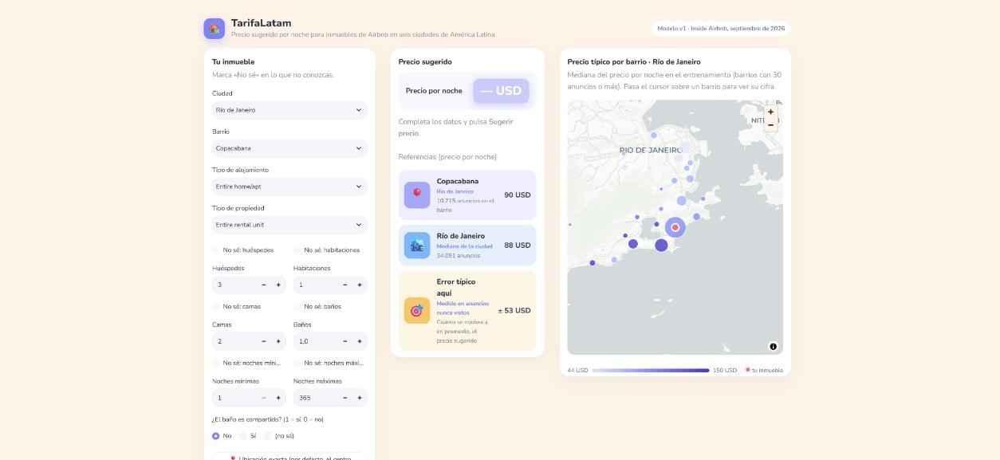

*Figura 12. La app desplegada (captura del 2026-11-06): formulario, referencias de precio y mapa de precios por barrio.*

## 9. Riesgos, límites y siguientes pasos

- **Qué NO hace el modelo:** no predice el precio que se **cobrará**, sino el **publicado**; no responde si un inmueble **se paga**
  (no hay ocupación, costos ni valor de compra); no debe usarse sin revisión en **Belice**, ni para habitaciones de hotel o
  compartidas. La tarifa la decide el anfitrión.
- **Límites de los datos:** una foto de **septiembre de 2026**, sin efecto de temporada; seis ciudades (cinco grandes y Belice), no
  Buenos Aires ni ciudades intermedias como Medellín o Cartagena; la prueba no tiene precios extremos (86 excluidos).
- **Uso responsable:** el modelo no usa datos del anfitrión, pero sí la **ubicación**, así que el precio refleja las desigualdades de
  cada barrio; antes de producción hay que revisar que no se use para discriminar zonas. La app muestra siempre el rango típico.
- **Mejoras propuestas** (de este documento, aún no decididas por el grupo): (1) tratar Belice aparte o restringirlo; (2) en
  producción, vigilar el **error por ciudad** con precios nuevos; (3) las de la sección 10.

## 10. Cómo continuar (versión 2)

Esta sección es para quien retome el proyecto sin haber participado. Todo lo que nombra existe en el repositorio.

**Mapa del repositorio**

| Carpeta o archivo | Qué hay |
|---|---|
| `especificacion-proyecto.md` | El caso, la métrica y la sección 7 con todas las excepciones y cambios decididos |
| `especificaciones/` y `specs/` | Guías de cada etapa y, por pieza de trabajo, `spec.md`, `plan.md` y `tasks.md` |
| `src/tarifalatam/` | Toda la lógica: `data/` (carga, limpieza, partición), `features/`, `models/` (torneo, optimización, validación), `tracking/`, `inference/` |
| `config.py` (en `src/tarifalatam/`) | Ciudades, monedas, tasas de cambio, columnas prohibidas y sospechosas, umbrales y semillas |
| `notebooks/01` a `09` | Una por etapa; solo orquestan (la lógica está en `src/`) |
| `tests/` | Pruebas `pytest` de cada función que limpia o transforma |
| `reports/` | Un informe por etapa con sus tablas y este informe |
| `models/` | `model.joblib`, `input_schema.json` y `ficha_modelo.md` |
| `app/streamlit_app.py` | La app |

**Cambios típicos y dónde se hacen**

- **Agregar una ciudad:** descargar su `listings.csv.gz` de Inside Airbnb a `data/raw/`; agregarla en `CITY_FILES`,
  `CITY_CURRENCY` y `FX_RATES` de `config.py` (tasa oficial del día del corte, con su fuente: si falta, `to_usd` se detiene);
  y ejecutar los notebooks 03 a 09. El notebook 09 regenera el esquema de la app (`build_schema`), con los barrios de la nueva
  ciudad.
- **Probar una variable nueva:** escribir su transformador en `src/tarifalatam/features/engineering.py`, con su prueba, y
  medirla en el notebook 04 con la misma regla. Las ideas descartadas siguen ahí, apagadas, como registro de lo que se probó.
- **Volver a entrenar con datos nuevos:** la prueba actual ya se usó; una versión 2 necesita una **prueba nueva** (por ejemplo,
  un corte posterior de Inside Airbnb) que se abra una sola vez.

**Propuestas para la versión 2** (registradas en los informes de cada etapa; ninguna está decidida)

- Definir desde el inicio la regla de variables con **ruido pareado**: con ella, las amenidades habrían pasado
  (`reports/04_features.md`).
- Si vuelve el precio típico del barrio, codificarlo **por anfitrión** y no por anuncio.
- **Belice** con un modelo aparte o fuera del alcance.
- Llevar el seguimiento a **Databricks**, como pide la regla 7 (hoy está en MLflow local).
- Precios **por fecha** (temporada) y más ciudades: necesitan datos de calendario y cortes de varios meses.

**Qué vigilar si se usa en producción:** el MAE y el sesgo por ciudad con precios nuevos, la parte de anuncios con error mayor
a la mitad de su precio y cuántas veces los usuarios marcan «No sé».

## Anexo: cómo reproducir el proyecto

1. **Entorno** (Python 3.12): `uv venv --python 3.12 .venv` y `uv pip install --python .venv/Scripts/python.exe -r requirements.txt`
   (en Mac/Linux, `.venv/bin/python`).
2. **Credenciales:** copiar `.env.example` como `.env`. Sin Databricks, usar `MLFLOW_FORCE_LOCAL=1` y `PYTHONUTF8=1`.
3. **Datos:** descargar los siete `listings.csv.gz` de Inside Airbnb con los enlaces del `README.md` y guardarlos en `data/raw/` con el
   nombre de la tabla, sin descomprimir (Buenos Aires se descarga pero se excluye del modelo).
4. **Notebooks, en orden:** `01` a `09` en `notebooks/` (caso, EDA, preprocesamiento, variables, torneo, optimización, validación,
   registro, inferencia). Los notebooks solo orquestan; la lógica está en `src/tarifalatam/`. El `07` abre la prueba **una sola vez**.
5. **Pruebas:** `pytest` (309 aprobadas al 2026-11-11).
6. **App:** `streamlit run app/streamlit_app.py`.
7. **Este informe:** `python scripts/report_figures.py` (figuras, unos minutos) y, con `requirements-informe.txt` instalado,
   `python scripts/build_report_pdf.py` (PDF).

---

### Lista de comprobación antes de entregar

- [ ] Las **10 secciones** tienen contenido y **cada decisión lleva su motivo**.
- [ ] Las cifras **coinciden** con `reports/07_validacion.md` y con la presentación.
- [ ] No hay credenciales, `.env` ni datos personales.
- [x] El enlace de la app abre en una ventana privada. *(Comprobado el 2026-11-06 en un navegador sin sesión.)*
- [ ] Un tercero puede reproducir el proyecto con el anexo.
- [x] Los roles del grupo están confirmados. *(2026-11-11.)*
